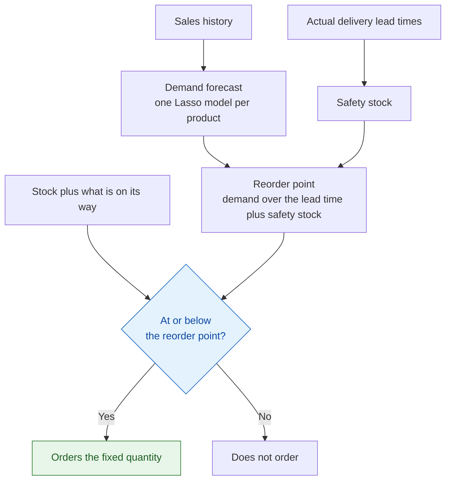

Versión en español: [README.md](README.md)

# Inventory replenishment with demand forecasting

[](https://github.com/jleonceo/reposicion-inventario-prevision-ml/actions/workflows/ci.yml)

**What it is.** An automated system that decides every day whether a replenishment order to the supplier is needed for
three products in a warehouse, with synthetic data.

**How it works.** It estimates the expected demand over the delivery time and sets a safety stock based on the actual
receipt lead times, instead of relying on the theoretical lead times the supplier promises.

**Result.** Simulated with the recorded demand of the first half of 2025, held back for the final test, our method cuts
the cost from €40,707 to €9,340: 77% less, a saving of €31,367.

The cost is the sum of the cost of holding stock, the margin on lost sales and the cost of each order. The €40,707 is
what the half year cost with the ordering rule the company uses today. The €9,340 is the median cost over 200 draws of
each order's lead time.

## How to run it

With Python 3.13:

```bash
git clone https://github.com/jleonceo/reposicion-inventario-prevision-ml.git && cd reposicion-inventario-prevision-ml
pip install -r requirements.txt
python ejecutar_todo.py --rapido
```

`ejecutar_todo.py` rebuilds the project from the CSV files in `datos/`. It prepares the data, trains the models,
calculates the safety stock, runs the final test and simulates the daily process. Finally, it checks that every figure
on this page comes from what it has just calculated. The code, the documents and the outputs are in Spanish.

## One day of the process

At the end of each day, the process calculates the reorder point of each product, which is the demand the model
forecasts over the lead time plus the safety stock. It then compares it with the stock, counting what is already on its
way. If the stock is at that point or below it, the process orders the product's fixed quantity.



This was the decision for 26/02/2025 in the half-year simulation:

<!-- ejemplo 2025-02-26 -->
| Product | Forecast demand over the lead time | Safety stock | Reorder point | Stock plus what is on its way | Decision |
|---|---|---|---|---|---|
| A | 905 | 131 | 1,036 | 918 | orders 1,500 units |
| B | 693 | 205 | 898 | 1,005 | no order |
| C | 569 | 422 | 991 | 971 | orders 600 units |
<!-- /ejemplo -->

The rule is the same for every product. A new product only needs its actual average lead time, its service target, its
safety stock and its order quantity.

## What changes compared with the current rule

With the same lead times drawn for both rules and adding up the three products, the system:

- raises the fill rate (units served divided by units ordered by customers) by 4.8 points;
- cuts the days without stock by 46;
- increases the average stock by €17,444, valued at cost.

Product by product, the system lowers the cost for B and C. For A it costs practically the same as the current rule;
the supplier of A takes, on average, as long as it promises.

## How it is built

| Document (in Spanish) | What it covers |
|---|---|
| [The data](docs/01_datos.md) | the three tables and how they are prepared |
| [The forecast](docs/02_prevision.md) | one Lasso model per product and how it is measured against the averages |
| [The safety stock](docs/03_stock_de_seguridad.md) | how it is calculated from the actual lead times and the measured error |
| [The simulator and the rules](docs/04_simulador_y_reglas.md) | how the five ordering rules are compared |
| [The final test](docs/05_prueba_final.md) | the comparison for each product and the system's result, with their bands |
| [The daily process](docs/06_produccion.md) | each day's decision, retraining and rollback |
| [Model card](docs/ficha_del_modelo.md) | what the model is for and what it is not for |

## Limitations

**Of the model.** Most of the saving comes from adjusting the calculation to the actual delivery lead times and to the
actual demand (instead of relying only on recorded sales). The model's predictive ability adds a small margin of
improvement and is only relevant for product C.

**Of the data.** The study was carried out with synthetic data, limited to three items and evaluated over a single
half year.

**Of the simulation.** The saving depends on how long each order takes to arrive. In the central 90% of the 200 draws,
the saving ranges from €25,933 to €32,371. As the demand is the recorded one, that band does not capture the randomness
of demand.

**Of the decision.** The single rule for every product was decided after seeing the final test. Everything the rule
uses (the model, the safety stock and each product's target) was fixed beforehand.

## Data and licence

The data is synthetic: it covers three products in a warehouse, from January 2023 to June 2025. There is no real
company behind it.

The code and the data are published under the [MIT](LICENSE) licence.

## Related repositories

- [store-sales-forecasting-ml](https://github.com/jleonceo/store-sales-forecasting-ml): daily sales forecasting by
  store and product, with one model per series and time-based validation.
- [tesoreria-forecast-ia](https://github.com/jleonceo/tesoreria-forecast-ia): cash forecasting validated with
  backtesting.
- [de-datos-en-bruto-a-decisiones](https://github.com/jleonceo/de-datos-en-bruto-a-decisiones): from a raw sales file
  to a dashboard, with every figure recalculated.
